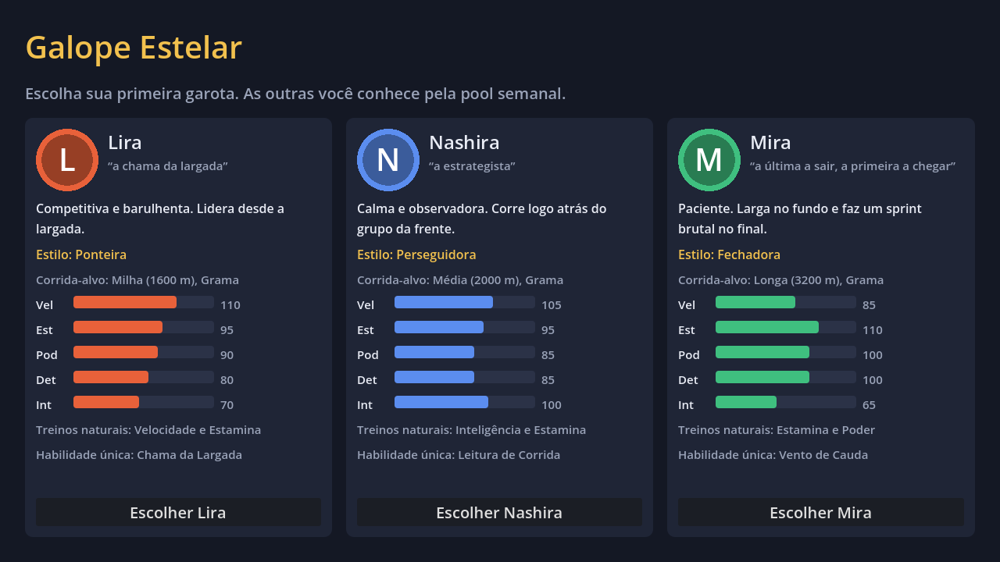
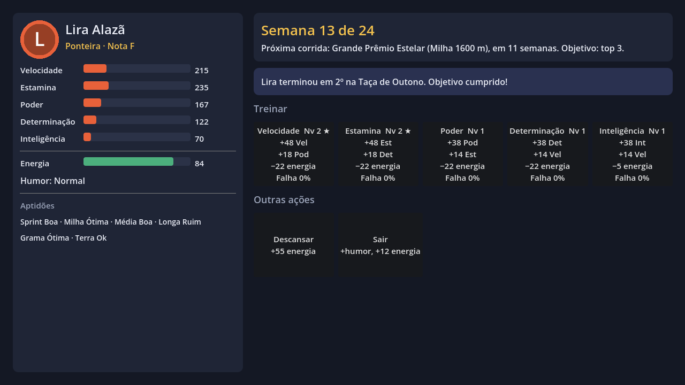
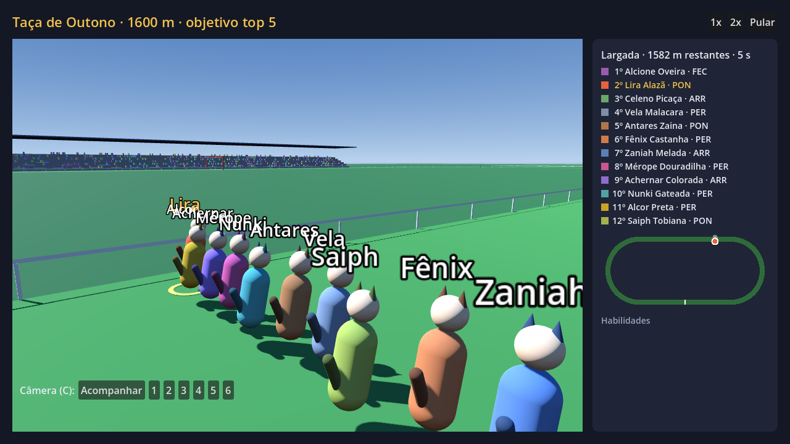
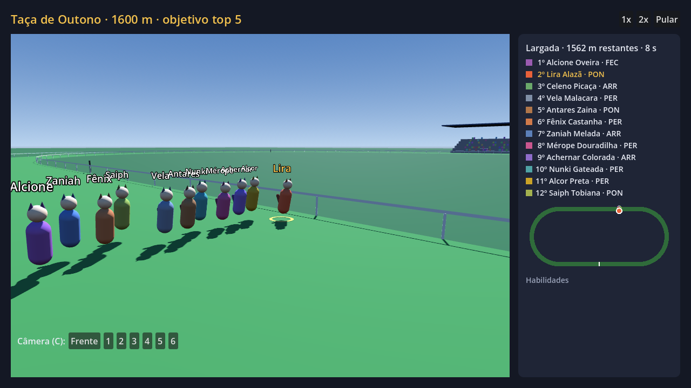
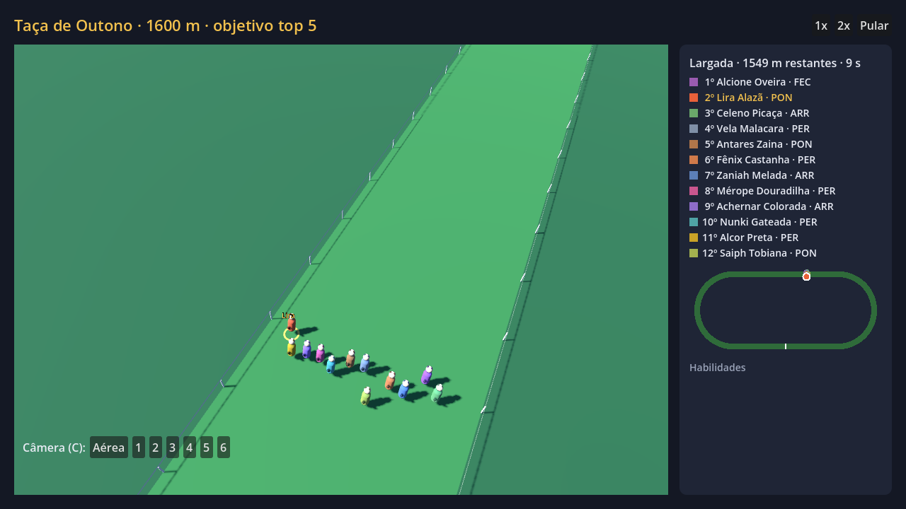
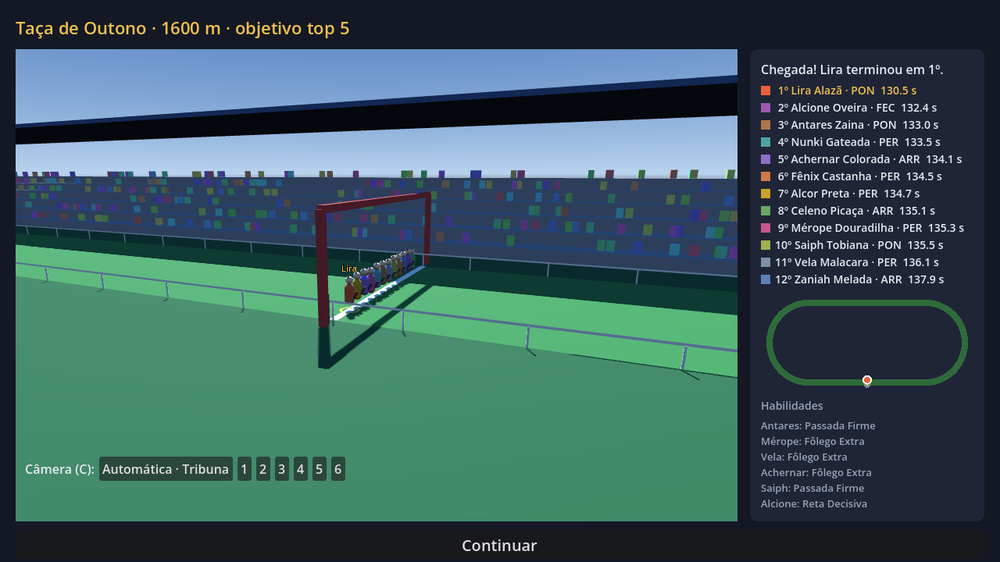

# Galope Estelar (stelar-gallop)

Simulador de treino e corrida de garotas cavalo. O design está em [docs/GDD.md](docs/GDD.md).

## Protótipo jogável (Godot 4.7)

O projeto Godot fica na raiz do repositório. Para jogar, abra o `project.godot` no Godot 4.7
e aperte F5, ou rode:

```
Godot_v4.7.2-stable_win64.exe --path .
```

**O que dá para fazer:** escolher uma das 3 iniciais, jogar uma carreira curta de 24 semanas
(treinar, descansar, sair, enfermaria) e disputar duas corridas-objetivo. Na Taça de Outono
(semana 12) o objetivo é o top 5, e no Grande Prêmio Estelar (semana 24) é o top 3. Se falhar
um objetivo, a carreira acaba. A corrida é assistida em 3D (primitivas placeholder), com
ranking ao vivo, minimapa, avisos de habilidade e botões 1x / 2x / pular.

**Câmeras da corrida:** Automática (troca sozinha conforme a fase, como numa transmissão),
Acompanhar, Lateral, Frente, Aérea e Tribuna. Troque com `C` ou com as teclas `1` a `6`.

**Fica para depois:** pool semanal, vínculo, encontros, compra de habilidades, save e circuito.
A arte é placeholder (formas coloridas).

| Arquivo | O que faz |
|---|---|
| `scripts/sim_corrida.gd` | Simulação da corrida, port fiel de [corrida.md](docs/corrida.md) e `tools/sim_corrida.py`. Não depende de tela. |
| `scripts/carreira.gd` | Regras da carreira. Os números de balanceamento ficam em `BAL`. |
| `scripts/dados.gd` | Autoload que carrega `data/garotas.json` e `data/iniciais.json`. |
| `scripts/corrida_3d.gd`, `scripts/pista_geo.gd` | Vista 3D da corrida (pista, corredoras, câmeras) e a geometria da pista em metros. |
| `scripts/tela_*.gd`, `scripts/main.gd` | Telas montadas em código (escolha, carreira, corrida, fim). |
| `testes/balanco.gd` | Joga carreiras com um bot e mede quantas cumprem os objetivos. |
| `testes/capturas.gd` | Passa pelas telas sozinho e salva capturas em `testes/capturas/`. |

### Testes

```
Godot_v4.7.2-stable_win64_console.exe --headless --path . --script res://testes/balanco.gd -- 200
Godot_v4.7.2-stable_win64_console.exe --path . --script res://testes/capturas.gd
```

Com 200 carreiras por inicial, o bot cumpre o primeiro objetivo em ~80% das vezes e, dessas,
o segundo em ~60%. Um jogador que cuida do humor e escolhe bem os treinos deve ir melhor.








## Outras ferramentas

- `tools/`: simulador de corrida e gerador do elenco em Python (ver [corrida.md](docs/corrida.md) §9).
- `visualizador/`: visualizador da corrida no navegador.
- MCPs do [Godot](docs/mcp-godot.md) e do [Blender](docs/mcp-blender.md) para o Claude Code.
