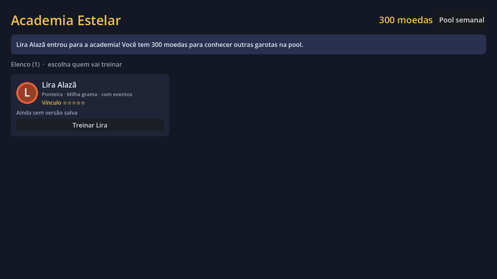
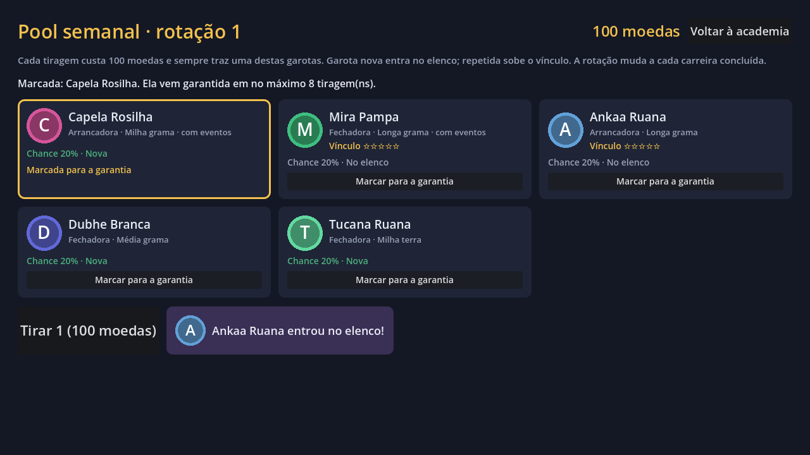
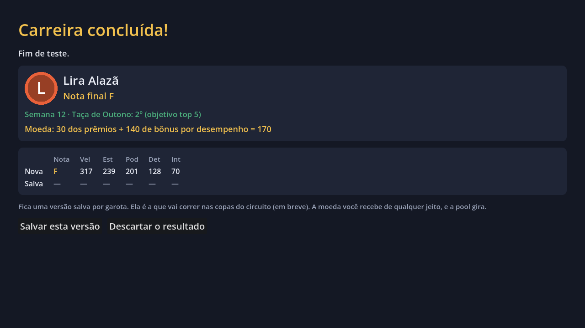
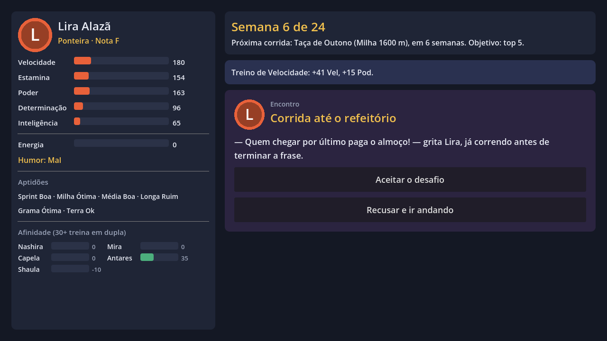
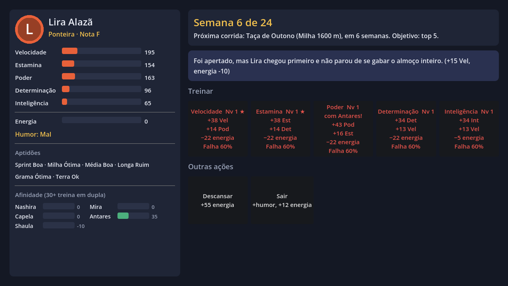

# Galope Estelar (stelar-gallop)

Simulador de treino e corrida de garotas cavalo. O design está em [docs/GDD.md](docs/GDD.md).

## Protótipo jogável (Godot 4.7)

O projeto Godot fica na raiz do repositório. Para jogar, abra o `project.godot` no Godot 4.7
e aperte F5, ou rode:

```
Godot_v4.7.2-stable_win64.exe --path .
```

**O que dá para fazer:** escolher a primeira garota entre 3 iniciais, conhecer outras na pool
semanal e jogar com qualquer garota do elenco uma carreira curta de 24 semanas
(treinar, descansar, sair, enfermaria) e disputar duas corridas-objetivo. Na Taça de Outono
(semana 12) o objetivo é o top 5, e no Grande Prêmio Estelar (semana 24) é o top 3. Se falhar
um objetivo, a carreira acaba. A corrida é assistida em 3D (primitivas placeholder), com
ranking ao vivo, minimapa, avisos de habilidade e botões 1x / 2x / pular.

**Câmeras da corrida:** Automática (troca sozinha conforme a fase, como numa transmissão),
Acompanhar, Lateral, Frente, Aérea e Tribuna. Troque com `C` ou com as teclas `1` a `6`.

**Encontros e afinidade:** em algumas semanas (mais ao Sair) aparece um encontro com 2 ou 3
escolhas. Há 3 eventos únicos por inicial e 6 genéricos com as colegas da academia, todos em
`data/encontros.json`. Os encontros mexem na afinidade, e colegas com afinidade 30+ podem
aparecer num treino para um bônus de dupla (+25%). A rival Polaris Moura corre o Grande Prêmio.

**Save:** a carreira é salva sozinha a cada turno (`user://carreira.json`). Na tela inicial
aparece o botão para continuar.

**Academia, pool e vínculo:** entre carreiras você fica na academia, com a moeda e o elenco.
A pool semanal mostra 5 garotas (2 com eventos e 3 só com dados), com chances iguais e
visíveis. Cada tiragem custa 100 moedas. Marque uma garota e ela vem garantida em no máximo
10 tiragens. Garota repetida sobe o vínculo (até 5), que dá +8 em cada atributo inicial e
+40 no limite por nível. A rotação gira a cada carreira concluída. No fim da carreira você
recebe moeda (prêmios das corridas e bônus por objetivo) e decide se a nova versão substitui
a salva. O perfil fica em `user://perfil.json`.

**Fica para depois:** calendário completo de 48 turnos ([calendario.md](docs/calendario.md)),
compra de habilidades e circuito de copas.
A arte é placeholder (formas coloridas).

| Arquivo | O que faz |
|---|---|
| `scripts/sim_corrida.gd` | Simulação da corrida, port fiel de [corrida.md](docs/corrida.md) e `tools/sim_corrida.py`. Não depende de tela. |
| `scripts/carreira.gd` | Regras da carreira. Os números de balanceamento ficam em `BAL`. |
| `scripts/perfil.gd` | Moeda, elenco, vínculo, versão salva de cada garota e a pool. |
| `scripts/dados.gd` | Autoload que carrega os arquivos de `data/` (elenco, iniciais, rivais, encontros). |
| `scripts/corrida_3d.gd`, `scripts/pista_geo.gd` | Vista 3D da corrida (pista, corredoras, câmeras) e a geometria da pista em metros. |
| `scripts/tela_*.gd`, `scripts/main.gd` | Telas montadas em código (escolha, carreira, corrida, fim). |
| `testes/balanco.gd` | Joga carreiras com um bot e mede quantas cumprem os objetivos. |
| `testes/teste_perfil.gd` | Testa a pool, a garantia, o vínculo, a moeda do fim de carreira e o save do perfil. |
| `testes/teste_save.gd` | Salva uma carreira, carrega de volta e confere se o estado é o mesmo. |
| `testes/capturas.gd` | Passa pelas telas sozinho e salva capturas em `testes/capturas/`. |

### Testes

```
Godot_v4.7.2-stable_win64_console.exe --headless --path . --script res://testes/balanco.gd -- 200
Godot_v4.7.2-stable_win64_console.exe --headless --path . --script res://testes/teste_save.gd
Godot_v4.7.2-stable_win64_console.exe --headless --path . --script res://testes/teste_perfil.gd
Godot_v4.7.2-stable_win64_console.exe --path . --script res://testes/capturas.gd
```

Com 200 carreiras por inicial, o bot cumpre o primeiro objetivo em ~80% das vezes e, dessas,
o segundo em ~60%. Um jogador que cuida do humor e escolhe bem os treinos deve ir melhor.










## Outras ferramentas

- `tools/`: simulador de corrida e gerador do elenco em Python (ver [corrida.md](docs/corrida.md) §9).
- `visualizador/`: visualizador da corrida no navegador.
- MCPs do [Godot](docs/mcp-godot.md) e do [Blender](docs/mcp-blender.md) para o Claude Code.
